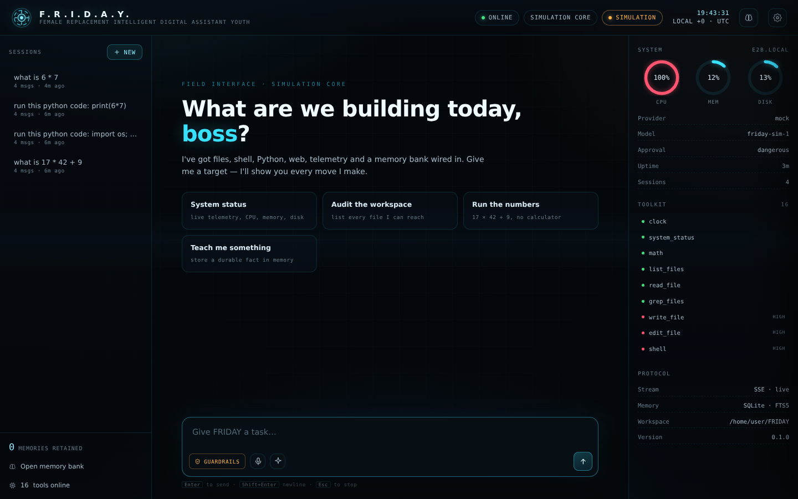
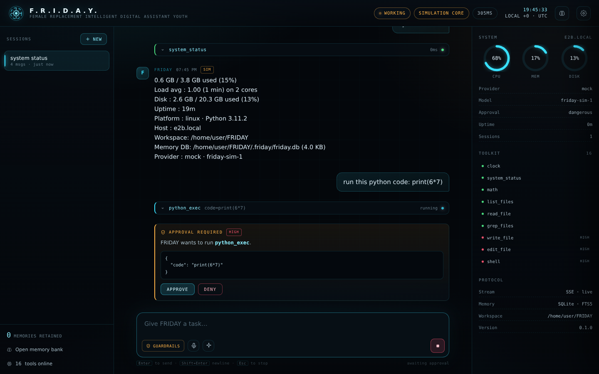
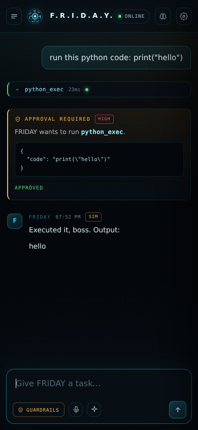

# F.R.I.D.A.Y.

**A local-first AI agent with a real memory, real tools, a streaming HUD, and a
human in the loop.**

FRIDAY is not a chat wrapper. It is a complete agent runtime: a synchronous ReAct
loop, a bi-temporal memory that compiles Markdown into SQLite/FTS indices, a
phase-gated toolset (4 → 18) behind a deterministic policy engine, an approval gate for dangerous actions,
a FastAPI + SSE web interface, a CLI, and a test suite that runs with **no API key
and no model download**.

```bash
pip install -e ".[serve]"
friday serve            # → http://127.0.0.1:8642/  (token printed once)
```

With nothing configured, FRIDAY boots its **simulation core**: the same loop, the
same retrieval, the same tools, the same approvals, the same HUD — driven by a
deterministic rule engine instead of a language model. Add a key or point it at
`llama-server` and the brain swaps without touching anything else.



---

## What is actually implemented

| Capability | What you get |
|---|---|
| **Agent loop** | `compile → generate → tool calls → observe`, step budgets, rung-0 output capping, retry, cancellation, partial-output persistence, explicit exhaustion/cancel outcomes. |
| **Memory** | Markdown is truth. Bi-temporal facts (world time *and* belief time), reconciliation, retraction, entities/relations, FTS5 + optional vectors, a memory compiler (episodes → facts → skills → weights), supervision spans. |
| **Retrieval** | FTS + vector + graph recall, concept lexicon, cross-encoder reranking (ONNX optional, lexical fallback), freshness/decay, score floor. |
| **Tools** | `memory_search`, `memory_write`, `note`, `read_artifact`; phase 1 adds `web_read`, `wiki`, `math`, `clock`; phase 2 adds the confined workspace (`ws_*`, `file_edit`, `file_grep`) and connectors (email, calendar, GitHub). |
| **Safety** | Injection containment with a trust boundary, secret redaction at the single fact chokepoint, deterministic policy engine, audited tool gateway, bearer token always, loopback bind by default, **no CORS wildcard**. |
| **Interface** | Streaming tokens, live tool timeline, inline approvals with a 190 s deny-on-timeout, session browser, memory panel, telemetry, voice input/output, phone layout. |
| **Proactive** | Heartbeat with deadlines, quiet hours and an annoyance budget; dreaming that proposes skill drafts; skills with shadow/active lifecycle. |
| **Providers** | OpenAI-compatible servers (llama.cpp, Ollama, LM Studio, vLLM, OpenRouter, Groq), Anthropic Messages, and the offline simulation core. |
| **Ops** | Docker + compose, Makefile, GitHub Actions matrix, wheel build, `friday doctor`. |

**892 tests pass, 2 are expected failures.** No network, no keys, no GPU.

---

## Quickstart

### 1. The zero-key path (recommended first run)

```bash
python -m venv .venv && source .venv/bin/activate
pip install -e ".[dev,serve]"
friday serve
```

Open the URL it prints. The first line of output names the token file
(`config/serve.token`, mode 0600). Paste the token into the HUD drawer; it is kept
in `localStorage` on your machine only.

Ask it something. You are talking to the simulation core: every subsystem except
text generation is real, so what you are testing is the memory and the plumbing.

### 2. A real local model

```bash
# any OpenAI-compatible server works; this is the one the project targets
llama-server -hf LiquidAI/LFM2-2.6B-GGUF:Q4_K_M -c 8192 --port 8080 --jinja

FRIDAY_LLM_URL=http://127.0.0.1:8080/v1 friday serve
```

`friday doctor` tells you what is reachable and what is degraded.

### 3. Anthropic

```bash
export FRIDAY_LLM_PROVIDER=anthropic
export ANTHROPIC_API_KEY=sk-ant-...
export FRIDAY_ANTHROPIC_MODEL=claude-sonnet-4-5   # optional override
friday serve
```

If the provider is selected but the key is missing, FRIDAY says so on stderr and
falls back to the simulation core rather than handing you a client that fails on
first use.

### 4. CLI only

```bash
friday chat                     # interactive
friday ask "what did I say about the reactor?"
friday build                    # Markdown truth → SQLite indices
friday rebuild                  # delete artifacts and rebuild (verifies Law 2)
friday tools --list
friday audit --today
friday holdout eval/holdout/README.md
```

---

## The HUD



The interface is hand-written: one HTML file, one stylesheet, one JS file, no build
step, no CDN. It has to work on a laptop with no internet, because that is the point
of a local-first agent.

* **Streaming** — `token` events render as they arrive; a non-streaming provider
  falls back to a single `message` event and the UI behaves identically.
* **Tool timeline** — `tool_call` → `tool_result`, matched by call id, with the risk
  colour and a one-line result.
* **Approvals** — `approval_required` blocks the worker thread; the browser POSTs a
  decision; a 190 s timeout denies. **Policy denials are never overridable by the
  approval mode** — "never ask" suppresses prompts, not permissions.
* **Memory panel** — lists live facts from the bi-temporal store; deleting retracts
  (the fact stays in history), it does not erase the record.
* **Voice** — browser `SpeechRecognition` / `speechSynthesis`, so no audio ever
  leaves the machine through FRIDAY.



---

## Architecture

```
                    ┌──────────────────────────────┐
   browser / phone  │  friday/web  (FastAPI + SSE) │
                    │  static HUD · approvals      │
                    └──────────────┬───────────────┘
                                   │  one turn, one thread
                    ┌──────────────▼───────────────┐
                    │  friday/agent  (the loop)    │
                    │  policy · tools · routing    │
                    └───┬───────────┬──────────┬───┘
                        │           │          │
              ┌─────────▼──┐ ┌──────▼─────┐ ┌──▼──────────┐
              │ retrieval  │ │  memory    │ │  security   │
              │ + ledger   │ │  + facts   │ │ + trust     │
              └─────────┬──┘ └──────┬─────┘ └─────────────┘
                        │           │
              ┌─────────▼───────────▼─────────┐
              │  SQLite/FTS artifacts +       │
              │  Markdown truth (memory/*.md) │
              └───────────────────────────────┘
```

**The loop is not in the server.** There is exactly one `Agent.run`, shared by the
CLI, the HUD and the eval harness. The server runs it on a worker thread and
translates its callbacks into SSE; it does not re-implement reasoning, memory or
policy. That is deliberate — two loops means two behaviours to debug.

**The core is stdlib-only.** `pip install friday` with zero extras gives you the
memory system, retrieval, the agent loop, the CLI and the stdlib gateway. FastAPI
and uvicorn live in `[serve]`; sentence-transformers, ONNX, watchdog and rich are
all optional and degrade to documented fallbacks. `friday serve` uses the HUD when
the extra is installed and falls back to the stdlib gateway when it is not;
`friday serve --classic` forces the zero-dependency path.

Deeper material:

* [`docs/UNIFIED.md`](docs/UNIFIED.md) — how the two lineages were grafted, and
  what was deliberately left behind.
* [`docs/INTEGRATION.md`](docs/INTEGRATION.md) — the measurement that decided the
  graft (branch containment, conflict map, capability split).
* [`docs/architecture/`](docs/architecture/) — the design documents: blueprint,
  memory compiler, attention ledger, security, research notes.
* [`AGENTS.md`](AGENTS.md) — the working rules for agents editing this repo.

---

## Security posture

This process can read and write your memory and run tools on your machine.
Exposing it is not like exposing a web page.

* **A bearer token is required on every route** except the page itself and
  `/api/health`. It is generated 0600 in `config/serve.token`.
* **Loopback by default.** `--host tailscale` binds the tailnet address only;
  `0.0.0.0` is allowed and prints exactly what it exposes.
* **No CORS wildcard.** Same-origin only.
* **Remote turns are audited as `remote`.** `friday audit --today` can distinguish
  network turns from keyboard turns.
* **Policy is enforced in the data layer**, not by asking the model nicely in the
  prompt. Confirmation is the *last* gate: every permission check has passed before
  a human is asked, so a "yes" can never stand in for a permission.
* **Secrets are redacted at the single fact chokepoint**, before Markdown, SQLite,
  FTS, vectors or supervision spans see them.

See [`SECURITY.md`](SECURITY.md) for the threat model and known gaps.

---

## Testing

```bash
make test        # 892 passed, 2 xfailed
make lint        # ruff: pyflakes + import order
make wheel       # builds a wheel and installs it into a scratch venv
```

The suite uses an isolated `FRIDAY_ROOT` per test, so a test can never write into
your real memory. It covers the loop, bi-temporal facts, retrieval gates, policy
ordering, injection containment, connectors, the gateway's 400 paths, the HUD's
REST contract, the SSE approval flow, the Anthropic converter and the file tools.

---

## Docker

```bash
docker build -t friday .
docker run --rm -p 8642:8642 -v "$PWD/data:/data" friday
```

`docker-compose up` does the same with the environment file. The image runs as a
non-root user; the memory volume is the only writable state.

---

## Repository layout

```
friday/
  agent/        loop.py · policy.py · tools.py · workspace.py · heartbeat.py
  memory/       facts.py (bi-temporal) · compiler.py · skills · supervision · traces
  retrieval/    pipeline.py · embedders · rerankers · concepts
  ledger/       compiler (attention ledger) · ladder · RSC telemetry
  security/     trust boundary · injection · redaction · netguard
  connectors/   email (IMAP/SMTP) · CalDAV · GitHub
  llm/          client.py (OpenAI-compatible) · anthropic.py · mock
  web/          app.py (FastAPI + SSE) · adapters.py · static/ (the HUD)
  serve.py      stdlib gateway (zero dependencies)
  cli.py        friday chat/ask/serve/build/doctor/…
tests/          892 passing tests
docs/           architecture/ · UNIFIED.md · INTEGRATION.md
eval/           locked retrieval suite + holdout format
```

---

## Provenance

This tree is the union of five branches that were built from the same one-line
commit. The short version: the cognition line (memory, retrieval, safety,
evaluation) is the trunk; the interface line (HUD, providers, extra tools)
contributed its surface. The merge was a graft, not a `git merge` — the two trees
both claimed `friday/` and produced 11 structural conflicts. `docs/INTEGRATION.md`
records the measurement; `docs/UNIFIED.md` records what was kept, ported and
retired.

One open research question survives the merge, deliberately: whether
`friday-dev`'s synonym bridges beat the mature concept lexicon on unseen
paraphrases. The committed numbers disagree with the held-out ones, and the module
is shipped unreferenced until a blind holdout settles it (T-012 in `BOARD.md`).

---

MIT. Built to run on a laptop, not a cluster.
