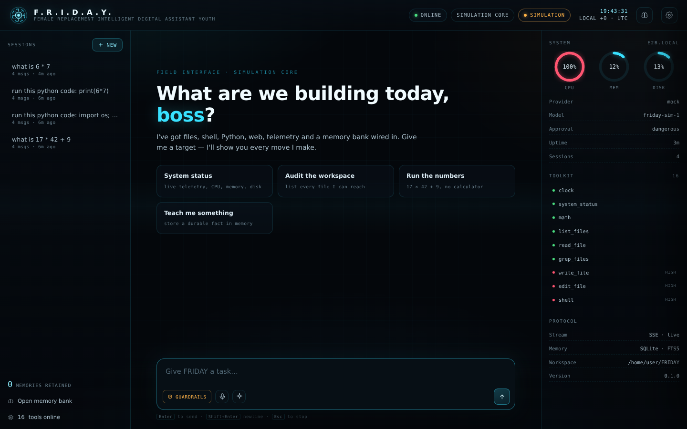
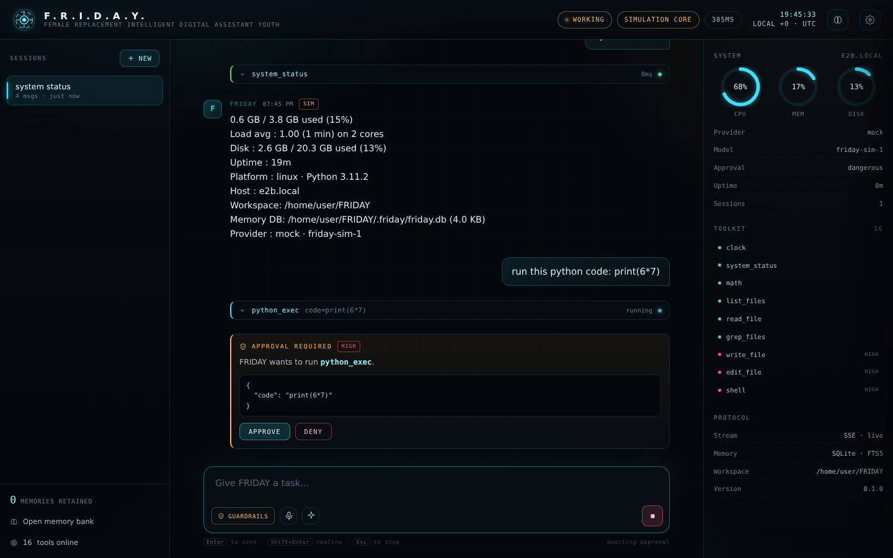
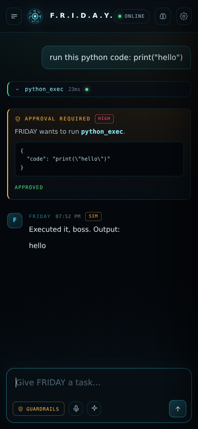

# F.R.I.D.A.Y.

**Female Replacement Intelligent Digital Assistant Youth** — a local-first AI agent with real tools,
durable memory, human-in-the-loop approvals, and a hand-built HUD.

[](https://github.com/Jaganravi131/FRIDAY/actions/workflows/ci.yml)
[](https://www.python.org/)
[](LICENSE)

> "Sometimes you gotta run before you can walk." — Tony Stark

FRIDAY is not a chat wrapper. It is a small, complete agent runtime: a streaming ReAct loop,
a provider abstraction that speaks OpenAI and Anthropic, sixteen sandboxed tools, SQLite memory
with full-text recall, an approval gate for dangerous actions, and a zero-dependency web interface.

**It runs with no API key.** With no provider configured, FRIDAY boots its deterministic simulation
core: the same loop, tools, memory, approvals, SSE stream and HUD, driven by a rule engine instead of
a language model. Add a key and the brain swaps without touching anything else.

```text
┌──────────────────────────────────────────────────────────────────────────────┐
│  F.R.I.D.A.Y.   ONLINE   ·   gpt-4o-mini   ·   guardrails                    │
├───────────────┬───────────────────────────────────────────┬──────────────────┤
│  SESSIONS     │  you › audit the workspace and fix        │  SYSTEM          │
│  ─────────    │        the failing test                   │  CPU ▓▓▓░░ 34%   │
│  ▸ Audit      │                                           │  MEM ▓▓▓▓░ 61%   │
│    Reactor    │  FRIDAY                                   │  DISK ▓▓░░░ 22%  │
│    Notes      │  Found it — `tests/test_core.py` imports  │                  │
│               │  a module that no longer exists.          │  TOOLKIT         │
│  + NEW        │  ⚙ edit_file  tests/test_core.py   ok 8ms │  ● list_files    │
│               │  ⚙ shell      pytest -q            ok 1.2s│  ● read_file     │
│  3 memories   │                                           │  ● shell         │
├───────────────┴───────────────────────────────────────────┴──────────────────┤
│  [guardrails]  🎙  ✦                          Enter to send · Esc to stop    │
└──────────────────────────────────────────────────────────────────────────────┘
```

---

## Look at it

| | |
|---|---|
|  |  |
| **The HUD at rest** — session browser, live telemetry, the toolkit on the right. | **Human in the loop** — a `python_exec` call blocked until approved, mid-stream. |



*The same interface on a phone: sessions become a drawer, telemetry folds away, approvals still work.*

---

## Why this exists

Most "agent" projects are a prompt and a `while` loop. FRIDAY is the rest of the iceberg:

| Capability | What is actually implemented |
|---|---|
| **Real agent loop** | Streaming ReAct loop with tool assembly, step + tool budgets, retry with backoff, cancellation, partial-output persistence, and a forced final synthesis when a budget runs out. |
| **Providers** | OpenAI-compatible streaming (OpenAI, OpenRouter, Groq, Ollama, LM Studio, vLLM…), Anthropic Messages API with tool use, and an offline simulation core. |
| **Tools** | Filesystem (jailed), grep, shell (guarded), Python subprocess, HTTP fetch (SSRF-guarded), web search, clock, math, telemetry, long-term memory, history search — plus a plugin loader. |
| **Memory** | SQLite with FTS5: sessions, full transcripts, tool calls, and durable facts injected into every system prompt. |
| **Approvals** | Risk-tiered human-in-the-loop. The browser gets an approval card mid-stream; the agent blocks until a decision or a timeout. A request can tighten the policy, never loosen it. |
| **Interface** | Vanilla JS HUD: SSE token streaming, live tool timeline, approval modal, telemetry gauges, session browser, memory bank, voice input, spoken replies. No build step, no CDN. |
| **Operations** | Typed config, CLI, 70 tests, ruff, Docker, CI, `.env` template, plugin example. |

---

## Quickstart

```bash
git clone https://github.com/Jaganravi131/FRIDAY.git
cd FRIDAY

python3 -m venv .venv
source .venv/bin/activate          # Windows: .venv\Scripts\activate
pip install -e .

friday serve                        # http://localhost:8000
```

You will land in the HUD with the **simulation core** active. Everything works: ask for
`system status`, `list the files in the workspace`, `what is 17 * 42 + 9`, or teach it a fact.

### Give it a real brain

Pick one:

```bash
export OPENAI_API_KEY=sk-...        # gpt-4o-mini by default
export ANTHROPIC_API_KEY=sk-ant-... # claude-sonnet-4 by default
export OPENROUTER_API_KEY=sk-or-... # any OpenRouter model
export GROQ_API_KEY=gsk_...         # llama-3.3-70b by default
```

…or run entirely local with [Ollama](https://ollama.com):

```bash
ollama pull llama3.2
FRIDAY_PROVIDER=ollama friday serve
```

Restart and the status chip switches from `SIMULATION` to your provider. Nothing else changes.

### CLI

```bash
friday chat                          # interactive terminal session
friday run "summarise README.md"     # one-shot
friday tools                         # the toolkit, with risk levels
friday sessions                      # saved conversations
friday doctor                        # configuration + environment diagnostics
```

---

## Configuration

Precedence: **built-in defaults → `friday.yaml` → `FRIDAY_*` environment variables**.

Copy `.env.example` or `friday.yaml.example` to get started. The essentials:

| Variable | Default | Notes |
|---|---|---|
| `FRIDAY_PROVIDER` | `auto` | `openai`, `anthropic`, `openrouter`, `groq`, `ollama`, `mock`, or any OpenAI-compatible name |
| `FRIDAY_MODEL` | provider default | e.g. `gpt-4o`, `claude-sonnet-4-20250514`, `llama3.2` |
| `FRIDAY_BASE_URL` | provider default | Point at LM Studio / vLLM / a gateway |
| `FRIDAY_API_KEY` | — | Falls back to the provider's standard `*_API_KEY` env var |
| `FRIDAY_TEMPERATURE` | `0.4` | 0.0–2.0 |
| `FRIDAY_MAX_STEPS` | `12` | Model turns per request |
| `FRIDAY_MAX_TOOL_CALLS` | `24` | Total tool executions per request |
| `FRIDAY_MAX_HISTORY_MESSAGES` | `80` | Transcript window sent to the model |
| `FRIDAY_APPROVAL` | `dangerous` | `never`, `dangerous`, `always` |
| `FRIDAY_WORKSPACE` | current directory | The filesystem jail |
| `FRIDAY_DATA_DIR` | `./.friday` | Sessions, memories, scratch files |
| `FRIDAY_HOST` / `FRIDAY_PORT` | `0.0.0.0` / `8000` | Server binding |
| `FRIDAY_PERSONA` | `friday` | `friday` or `stark` |
| `FRIDAY_API_TOKEN` | — | If set, mutating API calls require `X-FRIDAY-Token` |
| `FRIDAY_DISABLED_TOOLS` | — | Comma-separated tool names to remove |
| `FRIDAY_PLUGIN_DIRS` | — | Comma-separated plugin directories |
| `TAVILY_API_KEY` | — | Better web search; falls back to DuckDuckGo HTML |
| `FRIDAY_ALLOW_PRIVATE_FETCH` | off | Allow `fetch_url` to reach private addresses (trusted labs only) |

A `friday.yaml` is optional and identical in shape:

```yaml
provider: anthropic
model: claude-sonnet-4-20250514
approval: always
max_steps: 10
persona: stark
workspace: ~/projects
```

### The simulation core

If no key is configured, FRIDAY does **not** pretend to be a frontier model. It routes real intents
to real tools — system status, file listing and reading, math, memory, clock, code execution via
approval — and tells you plainly that a provider will make it smarter. It is deterministic, offline,
and exists so the entire system can be demonstrated, tested and developed without a credit card.

---

## The toolkit

| Tool | Risk | What it does |
|---|---|---|
| `list_files` | low | Walk the workspace, glob-filtered, depth-limited |
| `read_file` | low | Numbered UTF-8 lines, binary detection, range reads |
| `grep_files` | low | Regex search across workspace files |
| `write_file` | **high** | Create/overwrite, size-capped, approval-gated |
| `edit_file` | **high** | Exact-string replacement with uniqueness checks |
| `shell` | **high** | Command execution with a destructive-command denylist |
| `python_exec` | **high** | Isolated `python -I` subprocess, timed out |
| `fetch_url` | low | HTML→text fetch with SSRF + redirect protection |
| `web_search` | low | Tavily, or DuckDuckGo HTML without a key |
| `clock` | low | Timezones via `zoneinfo` |
| `system_status` | low | CPU, memory, disk, uptime, platform |
| `math` | low | AST-evaluated arithmetic, no `eval` |
| `remember` / `recall_memory` / `forget_memory` | low/medium | Durable facts with FTS |
| `search_history` | low | Full-text search across past conversations |

**Approval policy**

- `dangerous` *(default)* — low-risk tools run freely; medium/high need a human.
- `always` — every tool call needs a human.
- `never` — fully autonomous. Only inside a container or a machine you are willing to lose.

The HUD's mode switch can make this **stricter**, not looser: the server's policy is the floor.
Headless runs default to denying anything that would need approval rather than hanging.

**Filesystem jail:** every path is resolved (symlinks included) and must remain inside
`FRIDAY_WORKSPACE`. Attempts to escape return a clean error to the model.

---

## Architecture

```text
 Browser (vanilla JS HUD)
    │  POST /api/chat  ── SSE events ──▶ tokens, tool calls, approvals, done
    ▼
 FastAPI  ──  Agent loop (friday/engine.py)
                 │  build system prompt + memory block + trimmed history
                 │  stream model deltas ──▶ assemble tool calls
                 │  for each call: gate ─▶ execute ─▶ persist ─▶ feed back
                 ▼
       Provider (OpenAI-compatible │ Anthropic │ Simulator)
       Tool registry (jailed FS │ shell │ python │ web │ memory │ plugins)
       SQLite (sessions, messages, FTS5, facts)
```

More detail — event protocol, schema, threat model, trade-offs — in
[docs/ARCHITECTURE.md](docs/ARCHITECTURE.md). Plugin authoring lives in
[docs/PLUGINS.md](docs/PLUGINS.md).

### Project layout

```text
friday/
  config.py            typed settings, env/yaml precedence, provider resolution
  types.py             messages, tool calls, results, usage
  engine.py            the agent loop
  persona.py           system prompts
  memory.py            SQLite + FTS5 store
  cli.py               serve / chat / run / tools / sessions / doctor
  llm/                 openai_compat.py, anthropic.py, simulator.py, factory
  tools/               base registry, files, shell, web, system, memory_tools
  server/app.py        REST + SSE
  server/static/       index.html, style.css, app.js (no build step)
tests/                 70 tests: config, memory, tools, engine, server
docs/                  architecture, plugins
```

---

## API

All endpoints are under `/api`. Streaming uses `text/event-stream` with JSON frames.

| Method | Path | Purpose |
|---|---|---|
| `GET` | `/api/health` | Liveness, version, simulation flag |
| `GET` | `/api/config` | Safe configuration (never includes the key) |
| `GET` | `/api/tools` | Toolkit with risk and JSON schemas |
| `GET` | `/api/system` | Host telemetry + FRIDAY stats |
| `POST` | `/api/chat` | Run a turn; returns SSE |
| `POST` | `/api/chat/{run_id}/cancel` | Cooperative cancellation |
| `POST` | `/api/approvals/{token}` | Approve or deny a gated tool |
| `GET`/`POST` | `/api/sessions` | List / create |
| `GET`/`PATCH`/`DELETE` | `/api/sessions/{id}` | Read transcript / rename / delete |
| `GET`/`POST` | `/api/memory` | List/search / store a fact |
| `DELETE` | `/api/memory/{id}` | Forget |
| `GET` | `/api/history/search?q=` | Search all past messages |

SSE event types: `open`, `start`, `step`, `token`, `message`, `tool_call`, `tool_result`,
`approval_required`, `approval_result`, `notice`, `error`, `cancelled`, `done`, `close`.

```bash
curl -N http://localhost:8000/api/chat \
  -H 'Content-Type: application/json' \
  -d '{"message": "what is 17 * 42 + 9"}'
```

---

## Security model

FRIDAY is designed for a **trusted operator on a trusted machine**. Be precise about what that means:

- **Workspace jail** — file tools cannot resolve outside `FRIDAY_WORKSPACE`, including via symlinks.
- **SSRF guard** — `fetch_url` rejects loopback, private, link-local and reserved addresses on every
  redirect hop, and restricts ports to 80/443.
- **Shell denylist** — obvious catastrophes (`rm -rf /`, `mkfs`, fork bombs, piping downloads to a
  shell, `/etc/shadow`) are refused. This is a seatbelt, not a sandbox. `shell` and `python_exec`
  run with the privileges of the server process.
- **Approval gate** — high-risk tools block for a human decision by default; unattended runs deny.
- **API token** — set `FRIDAY_API_TOKEN` before exposing the port. The HUD accepts the token in
  settings; it is sent as a header and stored only in that browser's `localStorage`.
- **No key leakage** — `/api/config` never returns the API key, and the key never reaches the browser.

For multi-user, internet-facing or untrusted-prompt deployments: run FRIDAY in a container with a
read-only root, a dedicated workspace volume, no host network, and an API token. `docker-compose.yml`
gives you a starting point.

> Tool output is untrusted input. A fetched page can contain instructions. FRIDAY's prompt tells the
> model to treat tool output as data, but prompt injection is not "solved" by a sentence — the approval
> gate is the real boundary.

---

## Development

```bash
make install        # editable install + dev deps
make test           # pytest
make lint           # ruff check
make fmt            # ruff format
make serve          # run the HUD
make docker         # build the image
```

Or directly:

```bash
pip install -e ".[dev]"
pytest -q
ruff check friday tests
```

The interface is three static files. Edit `friday/server/static/*` and refresh; no build step, no
`node_modules`, no bundler. The only JS dependency is the browser.

### Docker

```bash
docker compose up --build
# HUD at http://localhost:8000, data persisted in the friday-data volume
```

Pass provider keys through the environment (`OPENAI_API_KEY`, …). The image runs as an unprivileged
user with the workspace mounted at `/workspace`.

---

## Roadmap

- [ ] Parallel tool execution with per-call approvals
- [ ] Token-aware context compaction (summarise instead of truncate)
- [ ] RAG over the workspace (embeddings + local vector index)
- [ ] Scheduled/background tasks ("wake me when the build breaks")
- [ ] MCP client + server support
- [ ] Multi-user auth and per-user workspaces
- [ ] WebSocket transport alongside SSE

---

## License

MIT. See [LICENSE](LICENSE).

Built with too much coffee and a healthy respect for arc reactors.
